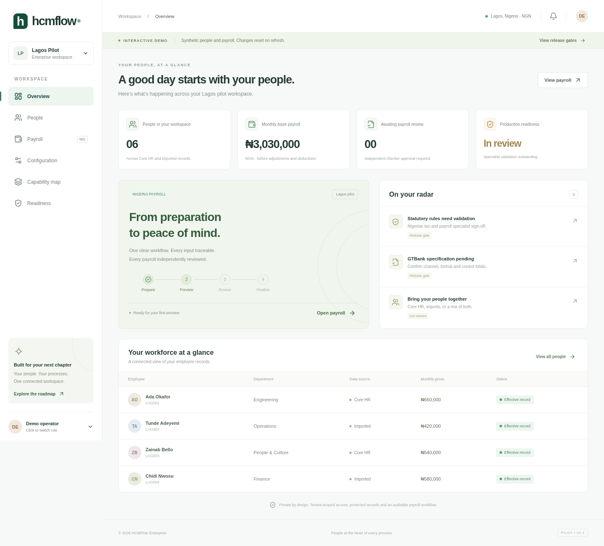

# HCMFlow Enterprise

A private, multi-tenant HR and Nigeria payroll platform. Python/FastAPI services, TypeScript/React workspace, PostgreSQL, and Docker Compose. This initial release is a **synthetic staging MVP**, not a production payroll engine.



## Try the GUI

The GitHub Pages workflow publishes a **synthetic, in-memory demo** at the URL reported in its deployment output. No login credentials, service URLs, database or real employee data are included. Refresh resets the demo. Switch between demo operator and independent reviewer using the bottom-left profile button.

Expected URL after Pages is enabled and a successful deployment: `https://sundayayandele.github.io/hcmflow-enterprise/`. A private repository requires a GitHub plan that supports Pages. The demo may be public; the source repository must remain private.

1. Explore Overview, People, Capability map and Readiness.
2. In Configuration, add a **monthly** calendar and a synthetic rule with invented test percentages. There are deliberately no default tax/pension rates.
3. Open Payroll → New preview and confirm period base inputs.
4. Switch demo role to reviewer, then approve and download a watermarked synthetic register/payslip summary.

The browser demo uses simplified calculations and does not reproduce backend authorization. Its simplified flat deductions are **not Nigerian tax logic**. The backend is the authority for real controls.

## Local staging stack

Prerequisites: Docker Engine + Compose v2, Python 3.12 for scripts/tests, Node 22+ for frontend development. Use synthetic data only.

```sh
python scripts/configure.py              # generates ignored .env, mode 0600
# In an inspected/proxied development environment, set BUILD_CA_FILE to its trusted combined CA bundle.
docker compose build
docker compose up -d --wait postgres
sh scripts/migrate.sh                    # explicit initial schema + FORCE RLS + runtime grants
docker compose up -d --wait
```

Open `http://127.0.0.1:8080`. There are **no default credentials**. Provision separate maker and checker accounts:

```sh
docker compose run --rm identity python -m hcm.cli provision --tenant lagos-pilot --name 'Lagos Pilot' --email maker@example.invalid --roles admin,hr,payroll
docker compose run --rm identity python -m hcm.cli provision --tenant lagos-pilot --name 'Lagos Pilot' --email checker@example.invalid --roles approver
```

The CLI prompts privately for passwords of at least 16 characters. Never put passwords on command lines, in issues, commits, or workflows. Runtime database roles are separate from schema owners. Do not run normal services with `compose.migrate.yaml`.

```sh
python -m venv .venv
.venv/bin/pip install -r backend/requirements.txt
.venv/bin/python -m pytest -q
.venv/bin/python scripts/smoke.py          # running Compose stack; creates synthetic tenants
bash scripts/restore-drill.sh            # isolated synthetic restore test
# Optional internal metrics and rules; no management ports published:
docker compose --profile monitoring up -d prometheus
```

CI creates and destroys a temporary Compose staging environment on GitHub-hosted runners. **Runners are not persistent hosting**. The VPS deployment is deferred at the user's request.

## Implemented slice

- Tenant provisioning, Argon2 password login, short-lived tenant-bound JWTs and role checks.
- Separate identity, workforce and payroll databases/runtime users on one PostgreSQL instance; FORCE RLS on tenant-owned workforce/payroll tables.
- Employee records with encrypted profile payloads and explicit Core HR/import source ownership. New imports support CSV, XLSX, XML and JSON, validation preview, all-or-nothing commit and replay safety. Existing-code updates are deliberately rejected pending source reconciliation workflow.
- Configurable calendars and effective-dated fixed/percentage-of-base elements through the internal API; monthly preview setup in the UI. Explicit per-period base amounts, decimal arithmetic, synthetic gross-to-net breakdowns, frozen input/rule snapshots, idempotency and maker-checker simulation approval.
- Watermarked simulation register, payslip summary and balanced control journal CSVs. GTBank, statutory schedules and production finalization return explicit blocked responses.
- Tenant-scoped business audit, runtime audit modification restrictions, structured diagnostic logs, health checks, internal Prometheus metrics and alert-rule templates.

## Release limits

No supplied statutory approval or completed review was found. No production statutory calculations are implemented. The synthetic flat deduction engine does not model PAYE bands, annualization, reliefs, applicability, pension rules, levies, final pay, retroactivity or statutory filing. No bank identifiers are collected; there is no GTBank format guess. Payslip CSVs are summaries, not final PDF payslips. Journal control accounts are demonstration accounts and do not implement customer chart-of-accounts posting. Employee self-service APIs have own-record restrictions, but employee UI linking, scoped manager grants, SSO/MFA and user lifecycle management require the next phase. Prototype shared signing keys must be replaced by asymmetric OIDC/service identity before production. No live data may be used until the release gates pass.

See [architecture](docs/ARCHITECTURE.md), [capability map](docs/CAPABILITY_MAP.md), [phased backlog](docs/BACKLOG.md), [security](docs/SECURITY.md), [operations](docs/OPERATIONS.md), [reference review](docs/REFERENCE_REVIEW.md), and [validation](docs/VALIDATION.md).
