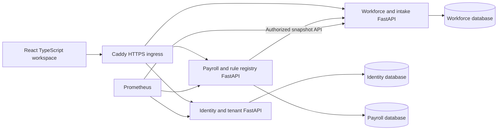

# Architecture decision record · 2026-11-08

## Deployment and domain ownership

Four small deployable Python services, one web image and one PostgreSQL process with four separately owned databases. Services do not join or read another service's tables. Identity owns tenants, memberships/login; workforce owns employee snapshots/import batches; payroll owns calendars, elements, rule metadata, run snapshots and results. Nigeria statutory is a domain within payroll initially; isolate it into a service when independently released jurisdiction packs justify the network cost. This avoids running a process for every feature on the first VPS.

API routes are `/api/{identity,workforce,payroll}/…`; internal OpenAPI is available directly inside the Compose network, blocked at ingress. Public integration keys/webhooks are deferred. Browser carries one authenticated tenant claim, never an arbitrary tenant header. Runtime reads/writes use tenant predicates plus transaction-local PostgreSQL RLS context. Connections clear context at transaction end. Database constraints enforce tenant-local employee-code, import-digest and payroll-idempotency uniqueness.

## Deliberate simplifications from reference architecture

- React/Vite SPA rather than Next.js: this transaction workspace needs no SSR, and a shared static GUI supports both Caddy and GitHub Pages. Use one frontend, no micro-frontends.
- Local Argon2 login for synthetic staging; production uses OIDC + MFA and asymmetric verification. Current service-to-service calls forward the user's short-lived token. Do not treat the shared symmetric JWT key as a production trust design.
- Initial imports/previews are synchronous and capped at 500 import rows / 200 payroll employees. Payroll takes a single workforce API snapshot and then operates on its own frozen inputs. A failed snapshot request creates no run.
- Redis, RabbitMQ, object storage, OTel collectors, Grafana and OpenSearch are deferred. They are not listed as running components. Add transactional outbox + idempotent worker, bounded retries and dead-letter handling before long imports, document/email delivery or scheduled jobs. Add object storage/scanning before attachments. Add OTel tracing and log aggregation before production operational commitments.
- New-record-only imports are intentional: mixed employee populations are supported, but field reconciliation, source switching, retroactive amendments and effective-dated employment history are separate backlog items. No silent overwrite.
- Synthetic rules are immutable versions with source, effective period, status and rule snapshot. No API can mark them production approved. The production calculator is disabled until a separately reviewed country pack and sign-off workflow exist.

## Money, controls and consistency

Money uses Decimal and explicit rounding to two decimal places; employee base inputs are per pay period. Monthly UI asks for confirmation before using monthly salaries. Other calendars can be configured, and API callers must supply explicit bases; no proration or annualization is inferred. A mid-period hire is rejected. Fixed/percentage elements are bounded and never execute arbitrary formulas. Preview snapshot stores employee code/id/version/source, calendar, elements, rule version, individual lines, totals and checksum. New rule configuration cannot rewrite an existing run. Maker cannot approve their own run even if they hold both roles. Concurrent approvals lock the run row. Production finalization always fails closed.

Separate database transactions include domain writes and an audit record. Runtime roles cannot update/delete/truncate audit history. This is not WORM storage against database administrators; export to independent tamper-evident storage is a production gate. No asynchronous delivery exists yet, so an outbox is not claimed.

## Growth path

Phase 1 extracts workforce operations and employee services when workflows land. Phase 2 adds talent acquisition/development domains, notifications and governed analytics projections. No analytics service gets unrestricted cross-tenant operational SQL. Separate stateless workers and data/observability hosts before single-host capacity is exceeded. Use identical images for future dedicated-client cells. Kubernetes is deferred until multiple cells, HA or independent scaling justify it.

A single VPS has no host-level HA. Start with measured capacity; under-200-employee pilot targets are hypotheses, not SLO guarantees. Off-site restore, latency and capacity evidence must precede production contracts.

## Enrichment increment · 10 November 2026

The workplace service adds typed operations, lifecycle, talent and employee-finance workflows in a separately owned fourth database, plus role-filtered operational summaries and staffing scenarios. Existing services add employee revisions and payroll evidence/comparison. See [scope and upgrade notes](ENRICHMENT_IMPLEMENTATION.md). These are initial workflows; production country-pack, payment and enterprise assurance gates remain unchanged.
